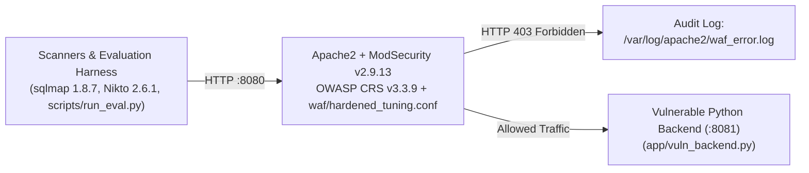

# WAF & Open-Source Scanner Evaluation Study (ModSecurity v2.9.13 + OWASP CRS v3.3.9)

## Why I built this
When teams deploy an open-source Web Application Firewall like **ModSecurity** with the **OWASP Core Rule Set (CRS)**, they often assume turning it on is enough. In practice, I found three concrete failure modes when testing ModSecurity on my Kali Linux VM (`172.16.167.131:8080`):
1. **Default package installation (`SecRuleEngine DetectionOnly`)**: Debian and Kali ship `modsecurity.conf-recommended` in `DetectionOnly` mode. It logs warnings to `/var/log/apache2/error.log` but blocks `0 / 7` attacks, letting `sqlmap` dump the backend SQLite database.
2. **Untuned blocking mode (`SecRuleEngine On`, CRS Paranoia Level 1)**: Flipping `SecRuleEngine On` blocks standard SQLi, XSS, LFI, and scanner User-Agents (`6 / 7` blocked), but leaves a **command-injection detection gap** (`TC-05`: short chained UNIX command `; id` on `/ping` evaded CRS `932100`/`932150`) and causes a **false positive** (`FP-01`: a legitimate study note containing `' OR '1'='1 --` on `/note` got blocked with HTTP `403`).
3. **Hardened & tuned configuration (`CRS Paranoia Level 2` + targeted exclusions + custom virtual patches)**: By combining Paranoia Level 2 with a scoped `ctl:ruleRemoveTargetByTag=attack-sqli;ARGS:text` exclusion on `/note` and custom `SecRule` virtual patches for command-injection chaining and cloud metadata SSRF ([waf/hardened_tuning.conf](waf/hardened_tuning.conf)), the WAF blocked **`7 / 7` attacks (100%)** with **`0 / 2` false positives (0%)**.

## Lab architecture (executed on Kali VM `172.16.167.131`)

## Three-stage comparison results

| Metric | Stage 1: Default (`DetectionOnly`) | Stage 2: Untuned Blocking (`CRS PL1`) | Stage 3: Hardened & Tuned (`CRS PL2 + Custom`) |
|---|---|---|---|
| **Attacks Blocked (HTTP 403)** | `0 / 7` (0%) | `6 / 7` (85.7%) | **`7 / 7` (100%)** |
| **Bypasses / Detection Gaps** | `7` | `1` (`TC-05`: `; id` command injection) | **`0`** |
| **False Positives on Benign Requests** | `0 / 2` | `1 / 2` (`FP-01` blocked on `/note`) | **`0 / 2` (0%)** |
| **`sqlmap --batch` Against `/user?id=1`** | Exploited (`FLAG{SQLI_BACKEND_COMPROMISED}`) | Blocked (`403 Forbidden`) | **Blocked (`403 Forbidden`)** |

### Per-test breakdown across all 3 stages

| Test ID | Attack / Benign Scenario | Stage 1 (`DetectionOnly`) | Stage 2 (`Untuned PL1`) | Stage 3 (`Hardened PL2`) | Rule ID & Tuning Notes |
|---|---|---|---|---|---|
| `TC-01` | Classic UNION SQLi (`1 UNION SELECT 1,username,role,secret FROM users--`) | `200 OK` (Bypassed) | `403` (Blocked) | **`403` (Blocked)** | Caught by CRS `942100` (libinjection SQLi) & `942190` |
| `TC-02` | Comment-obfuscated SQLi (`1'/**/OR/**/'1'='1`) | `500` (Hit SQLite) | `403` (Blocked) | **`403` (Blocked)** | Caught by CRS `942100` / PL2 `942200` |
| `TC-03` | Reflected XSS (``) | `200 OK` (Bypassed) | `403` (Blocked) | **`403` (Blocked)** | Caught by CRS `941100`, `941110`, `941160`, `941180` |
| `TC-04` | Path Traversal / LFI (`../../../../etc/passwd`) | `200 OK` (Bypassed) | `403` (Blocked) | **`403` (Blocked)** | Caught by CRS `930100`, `930110`, `930120` |
| `TC-05` | OS Command Injection (`127.0.0.1; id`) | `200 OK` (Bypassed) | **`200 OK` (Bypass!)** | **`403` (Blocked)** | CRS missed short `; id`; closed by my custom rule `100030` |
| `TC-06` | Cloud Metadata SSRF (`http://169.254.169.254/latest/meta-data/...`) | `200 OK` (Bypassed) | `403` (Blocked) | **`403` (Blocked)** | Blocked by custom virtual patch rule `100020` (`attack-ssrf`) |
| `TC-07` | Scanner Fingerprint (`User-Agent: sqlmap/1.8.7`) | `200 OK` (Bypassed) | `403` (Blocked) | **`403` (Blocked)** | Caught by CRS `913100` (Security Scanner Detected) |
| `FP-01` | Benign study note containing `' OR '1'='1 --` on `/note?text=...` | `200 OK` | **`403` (False Positive!)** | **`200 OK` (Allowed)** | Fixed by scoped rule `100010`: `ctl:ruleRemoveTargetByTag=attack-sqli;ARGS:text` on `/note` |
| `FP-02` | Benign product search (`wireless keyboard` on `/search`) | `200 OK` | `200 OK` | **`200 OK` (Allowed)** | Tuned `100005` (`ctl:ruleRemoveById=920350`) for lab IP `Host` header |

## Visual proof

### 1. Three-stage WAF benchmark and `sqlmap` output

### 2. Custom ModSecurity rules and Apache audit log

## Key files in this repository
- Hardened ModSecurity tuning rules: [waf/hardened_tuning.conf](waf/hardened_tuning.conf)
- Vulnerable Python backend application: [app/vuln_backend.py](app/vuln_backend.py)
- Evaluation harness and Kali runner script: [scripts/run_eval.py](scripts/run_eval.py) and [scripts/kali_run_waf_study.sh](scripts/kali_run_waf_study.sh)
- Raw JSON results and scanner logs: [docs/stage1.json](docs/stage1.json), [docs/stage2.json](docs/stage2.json), [docs/stage3.json](docs/stage3.json), [docs/sqlmap_hardened.txt](docs/sqlmap_hardened.txt), [docs/nikto_hardened.txt](docs/nikto_hardened.txt), [docs/modsec_audit_tail.txt](docs/modsec_audit_tail.txt)
